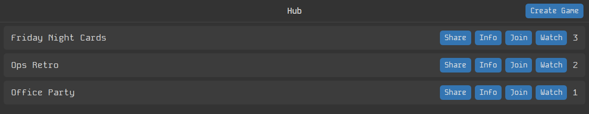
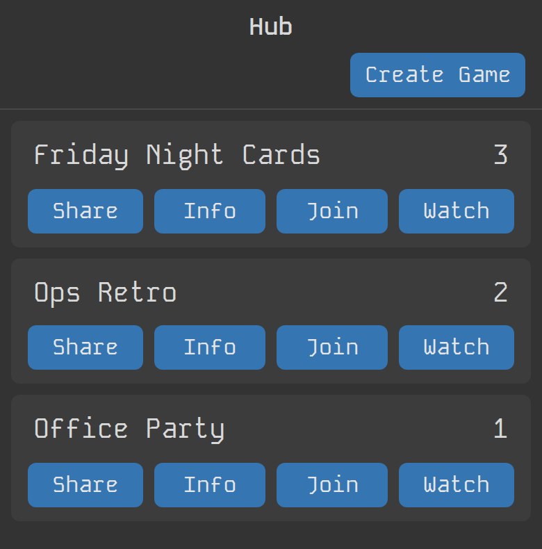

# web-game-framework

A lightweight, batteries-included framework for building multiplayer web games with Bun and WebSockets. Provides everything needed for real-time multiplayer without the complexity.





## Key Features

- **Bun-first runtime** - Optimized for Bun with minimal overhead and fast startup
- **WebSocket-based multiplayer** - Real-time communication out of the box
- **Opt-in modules** - Use `Server` alone, or add `Game`, `Database`, `EventRouter` and the lobby UI as you need them
- **Optional persistence** - Built-in save/load with JSON file database
- **Hot reload development** - Pages reload after each build, with `hotReload` from `@vanilla-bean/components/app`
- **Reference UI components** - Lobby components you copy and customize
- **Battle-tested** - Powers void-driller, sorcery-and-savagery, and humanity games

## Table of Contents

- [Installation](#installation)
- [Quick Start](#quick-start)
- [EventRouter](#eventrouter)
- [Core Architecture](#core-architecture)
- [Module Reference](#module-reference)
- [UI Components](#ui-components)
- [Examples](#examples)
- [Development](#development)
- [Contributing](#contributing)

## Installation

Install from npm:

```bash
bun add @fatlard1993/web-game-framework
```

Import in your application:

```js
// Core server modules
import { Server, Game, Database, basicGameRoutes } from '@fatlard1993/web-game-framework';
import { EventRouter } from '@fatlard1993/web-game-framework/core';

// Client modules
import socket, { onMessage } from '@fatlard1993/web-game-framework/client/socket';
import gameContext from '@fatlard1993/web-game-framework/client/gameContext';
import { createClientEventRouter } from '@fatlard1993/web-game-framework/client';

// Utilities
import { simpleId, shuffleArray, weightedChance, chance } from '@fatlard1993/web-game-framework/utils';
import '@fatlard1993/web-game-framework/utils/exit'; // exit handling for the server process
```

## Quick Start

### Minimal Server (~3 lines)

The simplest possible multiplayer server with WebSocket support:

```js
import { Server } from '@fatlard1993/web-game-framework';

// WebSocket automatically available at ws://localhost:3000/ws
const server = new Server({ port: 3000 });
```

That's it! WebSocket connections are handled automatically.

### With Game Class

Add game state management and player tracking:

```js
import { Server, Game } from '@fatlard1993/web-game-framework';

class MyGame extends Game {
	constructor(options) {
		super(options);
		this.score = 0;

		// Setup event handlers
		this.events.on('player:action', data => {
			this.incrementScore();
		});
	}

	toClient() {
		return {
			...super.toClient(),
			score: this.score,
		};
	}

	incrementScore() {
		this.score++;
		this.broadcast('scoreUpdated', { score: this.score });
	}
}

const server = new Server({
	port: 3000,
	Game: MyGame,
});
```

### With Database Persistence

Add automatic save/load for game state:

```js
import { Server, Game, Database } from '@fatlard1993/web-game-framework';

class MyGame extends Game {
	constructor(options) {
		super(options);
		this.score = options.saveState?.score || 0;
	}

	toSaveState() {
		return {
			...super.toSaveState(),
			score: this.score,
		};
	}
}

const database = new Database({ filePath: './data/games.json' });

const server = new Server({
	port: 3000,
	Game: MyGame,
	database,
});
```

Games automatically save on every `broadcast()` and load on server start.

### Client-Side Connection

**Recommended: Use EventRouter** for clean, declarative event handling:

```js
import { createClientEventRouter } from '@fatlard1993/web-game-framework/client';

const router = createClientEventRouter({ gameId: 'abc123' });

router.on('scoreUpdated', data => {
	console.log('New score:', data.score);
});

// Cleanup when done
router.destroy();
```

<details>
<summary>Alternative: Manual WebSocket handling (for simple cases)</summary>

```js
import socket, { onMessage } from '@fatlard1993/web-game-framework/client/socket';

const cleanup = onMessage(data => {
	if (data.update === 'scoreUpdated') {
		console.log('New score:', data.score);
	}
});

cleanup();
```

</details>

## EventRouter

Event-based message routing - cleaner alternative to switch statements. The Game class includes `this.events` (an EventRouter instance) for declarative event handling.

**Server-side:**

```js
class MyGame extends Game {
	constructor(options) {
		super(options);

		this.events.on('player:move', data => {
			const player = this.players.get(data.playerId);
			player.position = data.position;
			this.broadcast('playerMoved', data);
		});
	}
}
```

**Client-side:**

```js
import { createClientEventRouter } from '@fatlard1993/web-game-framework/client';

const router = createClientEventRouter({ gameId });
router.on('playerMoved', data => updatePlayerUI(data));
```

**API:**

- `this.events.on(eventName, handler)` - Register handler
- `this.events.defineEvent(name, { validate, throttle, transform })` - Define event
- `this.events.use(middleware)` - Add middleware
- `router.destroy()` - Cleanup

See [EventRouter.js](./core/EventRouter.js) source for full API.

## Core Architecture

### Design Philosophy

1. **Minimal Core** - Works for simple games without any plugins
2. **Opt-in Extras** - Persistence, event routing and the lobby UI are separate pieces
3. **Zero Lock-in** - Easy to eject and customize any part
4. **Incremental Adoption** - Use only what you need

### Module Overview

| Module | Purpose | Key Features |
| --- | --- | --- |
| **[Server](./core/Server.js)** | WebSocket server with Bun | Client tracking, broadcasting, hot reload sockets, health |
| **[Game](./core/Game.js)** | Base game state management | Player management, save/load, broadcasting hooks |
| **[EventRouter](./core/EventRouter.js)** | Event-based message routing | Validation, middleware, wildcards, throttling |
| **[Database](./core/Database.js)** | JSON file persistence | Collection-based CRUD, async init, auto-save |
| **[Players](./core/Players.js)** | Extended Map for player data | Convenience `update()` method |
| **[socket](./client/socket.js)** | Client WebSocket wrapper | Auto-reconnection, listener tracking |
| **[gameContext](./client/gameContext.js)** | Reactive game state container | Player management, `currentPlayer` access |
| **[utils](./utils/)** | Helper functions | ID generation, random helpers, exit handling |
| **[UI components](./ui/README.md)** | Optional lobby UI (copy & customize) | Layout, GameRoom views (Hub, Join, Create) |

All modules work independently. Use `Server` alone for raw WebSocket handling, or combine for complete game framework.

## Module Reference

### Server

WebSocket server with Bun runtime optimizations.

```js
import { Server } from '@fatlard1993/web-game-framework';

const server = new Server({
	port: 3000,
	hostname: '0.0.0.0',
	router: server => request => {
		/* ... */
	},
	Game: MyGameClass, // Optional
	database: dbInstance, // Optional
	wsPath: '/ws', // Optional, the game socket's path
	logger: myLogger, // Optional: { info, warning, error, debug }, defaults to a console logger
	verbosity: 3, // 0-3, controls logging detail
});

// Broadcast to all connected clients
server.socketBroadcast({ type: 'announcement', message: 'Hello!' });

// Development: build the client and reload pages after each rebuild
import { hotReload } from '@vanilla-bean/components/app';

if (process.env.NODE_ENV === 'development') await hotReload.watch();
```

**Features:**

- WebSocket client connection tracking
- Refuses sockets and writes sent by another site's page (`sameOrigin` from `@vanilla-bean/components/app`), before the app's router or the game socket hears them
- Broadcasting to all clients
- Accepts the page reload sockets of `hotReload` (from `@vanilla-bean/components/app`)
- Health monitoring with periodic stats
- Optional database integration: a `Database` instance, or a file path that the Server opens with its own logger
- Optional Game class integration

**Logging:** a `logger` needs `info`, `warning`, `error` and `debug` (plain `console` has no `warning`). Without one, the Server logs through `consoleLogger({ verbosity })` (`core/consoleLogger.js`): errors always, info from verbosity 1, warnings from 2 and debug from 3. A `Database` the Server opens from a path shares that logger; one built without a logger gets its own, tagged `[DB-INFO]` and the like, at verbosity 2.

### Game

Base class for game state management with player tracking and save/load.

```js
import { Game } from '@fatlard1993/web-game-framework';

class MyGame extends Game {
	constructor(options) {
		super(options);
		this.customState = {};
	}

	// Customize client data
	toClient() {
		return {
			...super.toClient(),
			customState: this.customState,
		};
	}

	// Customize save data
	toSaveState() {
		return {
			...super.toSaveState(),
			customState: this.customState,
		};
	}

	// Lifecycle hooks
	onPlayerAdded(player) {
		console.log('Player joined:', player.name);
	}

	onPlayerRemoved(playerId) {
		console.log('Player left:', playerId);
	}

	// Validation hook
	validateBroadcastData(key, data) {
		return typeof data === 'object';
	}

	// Augmentation hook
	augmentBroadcastData(key, data) {
		return { ...data, timestamp: Date.now() };
	}
}
```

**Built-in Features:**

- Player management (add, remove, update)
- Broadcasting with validation hooks
- Auto-debounced save (5 second delay)
- Extensible via lifecycle hooks

### Database

JSON file-based persistence with collection CRUD operations.

```js
import { Database } from '@fatlard1993/web-game-framework';

const db = new Database({
	filePath: './data/games.json',
	logger: myLogger, // Optional: { info, warning, error, debug }, defaults to a console logger tagged DB-
	onReady: db => {
		console.log('Database ready!');
	},
});

// CRUD operations
db.collections.games.create({ id: 'abc', name: 'Game 1' });
const game = db.collections.games.read({ id: 'abc' });
db.collections.games.update({ id: 'abc', update: { name: 'Updated Game' } });
db.collections.games.delete({ id: 'abc' });
db.collections.games.set({ id: 'abc', data: { id: 'abc', name: 'Replaced' } });

// Read all records
const allGames = db.collections.games.read();
```

### Client Modules

#### Socket

WebSocket wrapper with automatic reconnection and listener management, built on `connectSocket` from `@vanilla-bean/components/utils`. It connects to `/ws` when imported.

```js
import socket, { onMessage } from '@fatlard1993/web-game-framework/client/socket';

// Add message listener
const cleanup = onMessage(data => {
	console.log('Received:', data);
});

// Send messages
socket.send(JSON.stringify({ type: 'action', data: 'value' }));

// Check connection state
if (socket.readyState === socket.OPEN) {
	// Send data
}

// Cleanup listener
cleanup();
```

**Features:**

- Reconnects for as long as the page is open, backing off to every 10 seconds, and at once when the page comes back into view or the network returns
- One notice when the connection is lost and one when it's restored (requires `Notify` from `@vanilla-bean/components`)
- No page reload of its own: import `@vanilla-bean/components/app/reloadOnBuild` in the client for that
- Listeners, from `onMessage` or `socket.addEventListener`, carry over to each new connection

#### Game Context

An `Oxject` from `@vanilla-bean/components` (imported in `client/gameContext.js` as `Context`) holding `gameId` and `playerId`, with `players` as a `Players` map that knows the current player.

```js
import gameContext from '@fatlard1993/web-game-framework/client/gameContext';

gameContext.gameId = 'abc123';
gameContext.playerId = 'player1';

// Access the current player
console.log(gameContext.players.currentPlayer);

// Subscribe to changes
gameContext.subscribe({
	key: 'playerId',
	callback: playerId => console.log('Player changed:', playerId),
});
```

### Utilities

#### ID Generation

```js
import { simpleId } from '@fatlard1993/web-game-framework/utils';

const id = simpleId(); // "aB3xY" (5-char alphanumeric)
```

#### Random Utilities

`shuffleArray`, `weightedChance` and `chance` are re-exported from `@vanilla-bean/components/utils`, which also has `randInt` (min and max inclusive), `rand` and `randFromArray`.

```js
import { shuffleArray, weightedChance, chance } from '@fatlard1993/web-game-framework/utils';

// Shuffle array in-place (Fisher-Yates)
const deck = [1, 2, 3, 4, 5];
shuffleArray(deck); // [3, 1, 5, 2, 4]

// Weighted random selection (must sum to 100, or it throws)
const item = weightedChance({
	common: 70,
	rare: 25,
	legendary: 5,
}); // "common" (70% chance)

// Percentage chance test
if (chance(25)) {
	console.log('25% chance triggered!');
}
```

#### Exit Handling

Importing `utils/exit` runs `handleExit()` from `@vanilla-bean/components/app`: Ctrl+C exits 130, SIGTERM exits 0, an uncaught exception exits 99 and an unhandled rejection exits 1.

```js
// First line of your server entry point
import '@fatlard1993/web-game-framework/utils/exit';
```

## UI Components

Reference implementation of lobby UI components. **Not meant for direct use** - copy and customize for your game.

### Philosophy

Rather than being a universal UI kit, these components serve as **templates** you should copy and customize. Every game's UI needs differ, so the framework provides starting points instead of rigid components.

### What's Included

**Layout Components:**

- [View.js](./ui/layout/View.js) - Base view with toolbar + body
- [Toolbar.js](./ui/layout/Toolbar.js) - Top navigation bar
- [Body.js](./ui/layout/Body.js) - Content area; set `Body.backgroundImage` at startup for a parallax background behind every view

**GameRoom Components:**

- [Hub.js](./ui/GameRoom/Hub.js) - Game list/lobby: the library's `Toolbar` bar, a `Card` row per game, and an `EmptyState` when there are none
- [Join.js](./ui/GameRoom/Join.js) - Join existing game
- [Create.js](./ui/GameRoom/Create.js) - Create new game
- [GameList.js](./ui/GameRoom/GameList.js), [GameInfoPopover.js](./ui/GameRoom/GameInfoPopover.js), [GameInfoDialog.js](./ui/GameRoom/GameInfoDialog.js) - The Hub's list and its game info

**Other:**

- [QRCode.js](./ui/QRCode.js) - QR code for a join link

### Usage Patterns

#### Option 1: Copy & Customize (Recommended)

```bash
# Copy components as templates into your game
cp -r node_modules/@fatlard1993/web-game-framework/ui my-game/client/ui

# Customize styles, functionality, and structure for your needs
```

#### Option 2: Import Directly (Simple games only)

```js
import { Hub, Join, Create } from '@fatlard1993/web-game-framework/ui/GameRoom';

// Use directly (requires @vanilla-bean/components and matching API structure)
```

**Direct import assumptions:**

- `@vanilla-bean/components` installed
- API routes match expected structure (`/games`, `/games/:id`, etc.)
- Hash-based routing (`#/hub`, `#/join/:id`, etc.)

### Required API Structure

If using components directly, your server needs these routes. `basicGameRoutes()` provides them:

```
GET    /games                       # List all games
GET    /games/:id                   # Get game details
POST   /games                       # Create new game
POST   /games/:id/join              # Join game
POST   /games/:gameId/:playerId/exit # Leave game
DELETE /games/:id                   # Delete game
```

### When NOT to Use UI Components

- Your game doesn't need a lobby
- You're using a different UI framework (React, Vue, etc.)
- You want significantly different UX
- You're building a single-player game

In these cases, use the core framework (Server, Game, socket) and build your own UI from scratch.

**[Full UI Components Documentation →](./ui/README.md)**

## Examples

### Clicker Game

A multiplayer clicking competition: a `Game` subclass, `Database` persistence, REST routes and the socket.

```bash
cd examples/clicker-game
bun server.js
```

**[View clicker example →](./examples/clicker-game/README.md)**

For the lobby UI in use, see [humanity](https://github.com/fatlard1993/humanity), [void-driller](https://github.com/fatlard1993/void-driller) and [sorcery-and-savagery](https://github.com/fatlard1993/sorcery-and-savagery).

## Development

### Local Development

```bash
# Clone and install
git clone https://github.com/fatlard1993/web-game-framework
cd web-game-framework
bun install

# Run examples
cd examples/clicker-game
bun server.js

# Development (with your game)
bun --hot server.js   # Auto-restart on changes
```

### Project Structure

```
@fatlard1993/web-game-framework/
├── core/                # Server, Game, Database, Players
│   ├── Server.js        # WebSocket server with Bun
│   ├── Game.js          # Base game state management
│   ├── EventRouter.js   # Event-based message routing
│   ├── Database.js      # JSON file persistence
│   ├── Players.js       # Extended Map for players
│   ├── consoleLogger.js # Default logger
│   ├── router/          # basicGameRoutes
│   └── index.js         # Core exports
├── client/              # Client-side modules
│   ├── socket.js        # WebSocket with auto-reconnect
│   ├── gameContext.js   # Reactive game state
│   ├── eventRouter.js   # createClientEventRouter
│   ├── api.js           # REST API helpers
│   └── index.js         # Client exports
├── ui/                  # Reference UI components
│   ├── layout/          # View, Toolbar, Body
│   ├── GameRoom/        # Hub, Join, Create, GameList, game info
│   └── QRCode.js        # Join link QR code
├── utils/               # Helper utilities
│   ├── identifiers.js   # ID generation
│   ├── random.js        # Random helpers (from the library)
│   ├── exit.js          # Exit handling (from the library)
│   └── index.js         # Utils exports
├── examples/            # Example implementations
│   └── clicker-game/    # Clicker game example
└── docs/                # Documentation
    ├── GETTING_STARTED.md # Step-by-step tutorial
    └── img/             # README screenshots
```

### Running Tests

```bash
# Run test suite
bun test

# Watch mode
bun run test:watch
```

## Migration Guides

### From byod-web-game

1. Install package:
   ```bash
   bun add @fatlard1993/web-game-framework
   ```
2. Replace imports:

   ```js
   // Before
   import Game from '../byod-web-game/server/Game';
   import Server from '../byod-web-game/server/Server';

   // After
   import { Game, Server } from '@fatlard1993/web-game-framework';
   ```

3. Update Database imports if using persistence
4. Copy UI components if needed (don't import directly)

## Roadmap

**Phase 1 (✅ Complete):**

- Core Server, Game, Database
- Client socket with reconnection
- Utils (ID, random, validation)
- UI reference components
- Documentation

**Phase 2 (✅ EventRouter Complete):**

- ✅ EventRouter system - Event-based message routing
- ✅ Middleware support - Validation, logging, throttling
- ✅ All three games migrated (87 events total)
- ✅ Test suite (63 tests passing)
- 🚧 Plugin system architecture (in progress)
- 🚧 Built-in plugins: gameLoop, persistence, validation, spatialGrid

**Phase 3 (Future):**

- Advanced documentation
- More examples and tutorials
- Performance benchmarks
- Community plugins

## Browser Compatibility

**Server-side (Bun):**

- Bun 1.0.0+
- Node.js support not guaranteed (Bun-specific APIs used)

**Client-side (Browsers):**

- The last 2 versions of Chrome, Edge, Firefox and Safari (the `browserslist` in package.json)

No polyfills provided. Use transpilation for legacy browser support if needed.

## Contributing

1. **Fork and clone** the repository
2. **Create feature branch** from `main`
3. **Follow existing patterns** - Check similar modules for code style
4. **Add JSDoc comments** - Document all public APIs
5. **Update documentation** - Include README updates and examples
6. **Test thoroughly** - Run `bun test` and the examples; the pre-commit hook runs the changed folders' tests and `bun run format`

## Status

🚧 **Alpha v0.1.0** - Core extraction complete. API may change. Battle-tested in production games.

## License

MIT License (see `license` in package.json).

---

**[Getting Started Guide](./docs/GETTING_STARTED.md)** • **[Examples](./examples/)**
